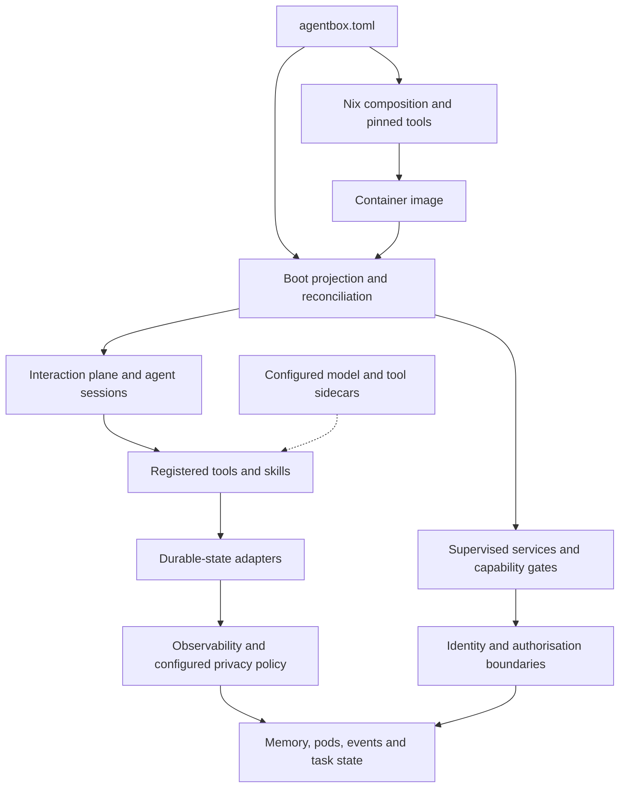

<div align="center">

# Agentbox

### A manifest-driven working environment for software agents

**Compose tools, sessions, identity and durable-state integrations in a Nix-built container.**

[Start](#quickstart) · [Architecture](#how-it-fits-together) · [Capabilities](#capabilities) · [Status](#working-status) · [Docs](docs/README.md) · [Licence](LICENSE)

</div>


*Illustrative artwork, not a runtime capture. The architecture below describes the implemented contracts.*

Agentbox packages agent CLIs, development tools and supervised services behind one configuration and build process. An operator chooses capabilities in `agentbox.toml`, inspects the resulting runtime contract, and runs interactive agent sessions with configured identity, memory and data services.

Use it for a persistent coding workspace, an auditable agent lab, local media/spatial tooling, or a host for governed repository-maintenance workflows. Nix pins the build inputs; runtime credentials, mounted data, model services and deployment state remain separate. A reproducible composition is not a guarantee that every action or external service is reproducible.

## Quickstart

From the machine that will host the container:

```sh
git clone https://github.com/DreamLab-AI/agentbox.git
cd agentbox
./scripts/start-agentbox.sh
```

The onboarding flow configures the manifest and deployment prerequisites. Read [installation](docs/user/installation.md), [providers](docs/user/providers.md) and [configuration](docs/user/configuration.md) before enabling services that need credentials, host devices or external endpoints.

For the prebuilt-image path:

```sh
export AGENTBOX_IMAGE_REF=ghcr.io/dreamlab-ai/agentbox:latest
docker pull "$AGENTBOX_IMAGE_REF"
./agentbox.sh up --registry
./agentbox.sh health
./agentbox.sh shell
```

Use an explicit image digest when you need an identified deployment. `latest` is a moving tag, not a reproducibility receipt. Review the generated Compose configuration and host mount paths; a Docker command issued inside another container resolves bind paths on the Docker host.

### Update a running workspace

```sh
./scripts/agentbox-config-validate.sh
./agentbox.sh prepare
```

`prepare` builds and delivers a candidate without replacing the running Agentbox. Inspect its evidence and use the [incremental-build and recovery runbook](docs/developer/incremental-builds.md) before activating it. `./agentbox.sh activate` replaces Agentbox; it is a deliberate operational step, not a documentation check.

Image-scoped SBOM/VEX evidence is described in [the vulnerability guide](docs/developer/vex.md). Its scope is the identified image, not the host, mounted secrets, sidecars or every service reachable from an agent.

## How it fits together



The five durable-state adapter slots are **beads, pods, memory, events and orchestrator**. Each selects a configured implementation class or `off`. These slots are not universal interception of filesystem writes or arbitrary tool/network calls. Observability and privacy wrap adapter dispatch; linked-data encoding is a separately gated route-level stage. Read [the baseline](docs/BASELINE-container.md) and [adapter guide](docs/developer/adapters.md) for the current contract.

The interaction plane uses Agent of Empires behind the configured identity ingress. Sessions can bind a `did:nostr` identity, URN, task epic and scoped memory namespace. Tool permissions and signing authority remain distinct from an identity label. See [ingress and identity](docs/INGRESS-identity.md).

## Capabilities

| Area | What the configuration selects | Boundary |
|---|---|---|
| Agent development | Agent CLIs, toolchains, registered skills and commands | Registrations and actual baked versions come from the selected build |
| Browser/media/spatial tools | Browser, Mermaid, ComfyUI, Blender, QGIS and related tooling | Many execute in sidecars or on configured hosts; Agentbox's `mmdc` is a client of browsercontainer, not a local browser |
| Durable memory | MCP access to the RuVector/Postgres sidecar | The mandatory memory service has no in-process SQLite fallback |
| Pods and identity | Native Solid pod service, bridges and configured signing paths | Feature gates, credential custody and receipts determine authority |
| Knowledge work | Released Ontomark corpus tools plus `vault` governance/query surfaces and Loom integration | Retrieval does not authorise a mutation or validate every agent assertion |
| Repository improvement | Product-specific host over the extracted Dream Engine crates | A gate verdict, published draft and human merge are distinct stages |
| Telemetry | Configured tracing, logs and metrics | Coverage follows the instrumented dispatch paths |

Skill and server counts change with registrations and build choices. Consult the manifest, generated runtime inventory and [registration instructions](AGENTS.md) rather than a copied catalogue count.

<details>
<summary><strong>Privacy, hardening and role isolation</strong></summary>

Privacy redaction is configured per adapter slot. Strict, soft and disabled policies have different failure behaviour. It does not intercept every file, prompt or outbound tool call; inspect the relevant path before making a confidentiality claim.

The container composition includes non-root operation, reduced capabilities, read-only-rootfs policy and supplemental syscall restrictions where configured. Host mounts, Docker access and external services alter the effective boundary. The container runtime, operator configuration and credential custody matter as much as a default manifest.

`[security].role_isolation` is **false in the inspected manifest**. The role-account and identity-port work therefore must not be described as active merely because its implementation exists. Enabling it requires the documented rebuild/activation path. See [capability governance](docs/GOVERNANCE-capabilities.md) and [the identity baseline](docs/INGRESS-identity.md).

</details>

<details>
<summary><strong>Identity, memory and provenance contracts</strong></summary>

Canonical identifiers are minted through [`management-api/lib/uris.js`](management-api/lib/uris.js). Sharing a Nostr public key format does not make every service share the same access policy, and not every generated file is automatically attributed.

Durable shared memory uses the MCP tools and the configured embedding pipeline. Raw database writes or bypass CLIs can produce rows that semantic retrieval cannot find. The [memory baseline](docs/LEARNING-memory.md) records the geometry, recall gates and lifecycle rules.

Pod provenance is feature- and outcome-dependent: storing bytes, committing a local mark and confirming an external anchor are different receipt stages. The pod server can report a successful resource write with incomplete provenance; consumers must read the receipt rather than infer it from HTTP success.

Governance proposals, responses and application receipts also have distinct owners. The runtime can forward and journal them; it does not turn every action into a human-approved mutation. See [identity mesh](docs/developer/identity-mesh.md), [sovereign mesh](docs/developer/sovereign-mesh.md) and [the economy loop](docs/developer/economy-loop.md).

</details>

## Recent source changes

The October history since the previous README update includes these independently reviewable changes:

- **Certificate trust:** the next image replaces the affected eMudhra trust in the Nix CA bundle and forces Node onto the same corrected bundle. The change is staged until the owner rebuilds and runs the two-client trust gate; the currently running container remains affected.
- **Corpus tooling:** refreshed Ontomark pins and corpus verbs; the vault layout uses its manifest path authority. `vault` gained the newer derivation-certificate/consequence tooling through an identified VisionClaw source pin.
- **Dream Engine:** the host consumes the extracted permissive crates and now carries requested-source supply and structured operator decisions. [ADR-2143](docs/adr/ADR-2143-source-supply-is-plumbing-and-decisions-are-plain-english.md) records the host contract.
- **Pod forge:** alpha.17 server features include forge and mirror support. [ADR-2145](docs/adr/ADR-2145-the-solid-pod-forge-and-mirror-are-compiled-in-and-inert-until-named.md) records a 20 October deployment with `/forge` responding and **zero** mirror follows/announce relays. A running forge is not automatic mirroring or a VisionClaw forge route.
- **Activity sink:** the hook merged under [ADR-2146](docs/adr/ADR-2146-activity-sink-hook.md), remains default-off and needs explicit endpoint/token configuration. It is no longer only an unmerged Codescape branch.
- **Instruction projection:** [ADR-2144](docs/adr/ADR-2144-the-floor-is-a-managed-tier-and-a-decline-is-recorded-verbatim.md) records the managed instruction tier and decline recorder, including dated activation evidence.
- **Identity and dependencies:** signed epoch-ticket/inbox-key handling and locked toolchain updates landed on 21 October. Source validation of those changes does not imply the current image contains them.

## Working status

**Source reviewed 21 October 2026 at `cd72f3a1e`.** The manifest and current source are authoritative for selected features; an image digest, boot/readiness report and acceptance receipt establish what a deployment uses.

The dated forge/instruction deployment receipts above describe specific 20 October behaviour. This README refresh did not rebuild or activate an image, rerun the full runtime suite, verify current memory recall, or certify cross-organisation federation. Older July status tables and performance totals do not describe the present runtime.

## Where it sits in VisionFlow

| Project | Relationship |
|---|---|
| [VisionFlow](https://github.com/DreamLab-AI/VisionFlow) | Cross-estate architecture and compatibility guide |
| [VisionClaw](https://github.com/DreamLab-AI/VisionClaw) | Knowledge application and graph observations; a separately deployed consumer |
| [solid-pod-rs](https://github.com/DreamLab-AI/solid-pod-rs) | Native pod and forge implementation, selected by Agentbox's build |
| [nostr-rust-forum](https://github.com/DreamLab-AI/nostr-rust-forum) | Communication and governance contracts |
| [Loom](https://github.com/DreamLab-AI/loom) | Configured grounding/model service |
| [Ontomark](https://github.com/DreamLab-AI/ontomark) | Shared Markdown-ontology toolchain |
| [dream-engine](https://github.com/DreamLab-AI/dream-engine) | Reusable gate/loop libraries; Agentbox owns its product-specific host |
| [sidestr-rs](https://github.com/DreamLab-AI/sidestr-rs) | Economic protocol libraries; chain-instance configuration stays in [`config/sidechain/`](config/sidechain/) |

## Documentation, contribution and licence

[Docs hub](docs/README.md) · [Quickstart](docs/user/quickstart.md) · [Architecture](docs/developer/architecture.md) · [Testing](docs/developer/testing.md) · [Backup/recovery](docs/user/backup-restore.md) · [Decision ledger](docs/adr/README.md)

Validate the manifest before changing build/runtime behaviour, classify apply behaviour correctly and use the relevant contract gates. Published ports, credential handling, identifier rules and adapter dispatch are architectural contracts.

The core project uses [AGPL-3.0](LICENSE). Bundled tools and extracted libraries have their own terms; see [the licensing matrix](docs/developer/licensing.md) and third-party notices. Maintained by [John O'Hare](https://github.com/jjohare) / DreamLab AI, with upstream attribution in [MAINTAINERS.md](MAINTAINERS.md), including Melvin Carvalho's Solid/JSS work.

Codex sessions persist in `agentbox-codex-home`; existing tmpfs installations
need a [one-time migration](docs/adr/ADR-2147-retain-codex-session-state.md) before replacement.

Media control-plane update: Blender retains its socket/background-job path and
adds an internal typed DCC-MCP gateway; external ComfyUI includes its MCP
dependencies. See [ADR-2148](docs/adr/ADR-2148-remote-media-control-planes.md).

Optional headless physics runs in the separate Isaac Sim sidecar, with a single
GPU UUID, an internal job API and motion export to Blender. Its build and
physics verification are independent of Agentbox readiness; see
[Isaac operations](docs/developer/isaac-sim.md).
