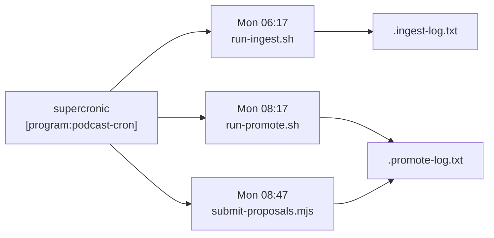
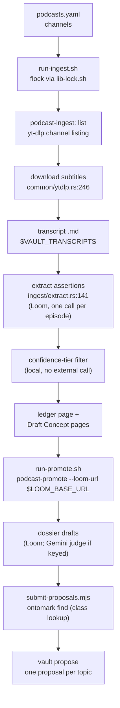

# Podcast Pipeline Diagrams

How podcast episodes become ledger pages and governed ontology proposals. Paths are relative to
`skills/podcast-knowledge-ingest/` unless noted; the binaries come from `services/podcast-ingest`.
Last edited 2026-11-11 (ADR-2196), when the weekly run was repaired after three weeks of silent
failure.

---

## 1. Flow: the weekly schedule

`[program:podcast-cron]` (flake.nix, gated by `[skills.podcast_ingest]`) runs supercronic over
`crontab`. Its `environment=` PATH is the whole toolset the jobs need: the two binaries, the
Python env (yt-dlp), coreutils (`tee`), util-linux (`flock`, for `lib-lock.sh`), Node, and
`vault`/`ontomark` from `vaultPackages`. Each job appends to a log in `$VAULT_TRANSCRIPTS`.

## 2. Flow: ingest, promote, submit

## 3. Failure modes seen on 2026-11-11

| Stage | Symptom in the logs | Cause | State |
|---|---|---|---|
| Ingest | "No new episodes" every week to 19 Oct | wrong channel handle | fixed in `podcasts.yaml` (October) |
| Ingest | "flock not found on PATH" every run after 19 Oct | util-linux missing from the cron PATH | fixed in flake.nix; live at the next image build |
| Ingest | HTTP 429 on subtitle download | YouTube rate limiting | open: not a code fault |
| Promote | "Loom reachability: UNREACHABLE" | default `http://loom:8080/v1` does not resolve here | fixed: `run-promote.sh` passes `$LOOM_BASE_URL` |
| Submit | "no `ontomark` binary" | ontomark missing from the cron PATH | fixed in flake.nix; live at the next image build |

The cron lines pipe through `tee`, so a failing job still exits 0 to supercronic; read the two
logs, not the supervisor status, to tell whether a week succeeded.
