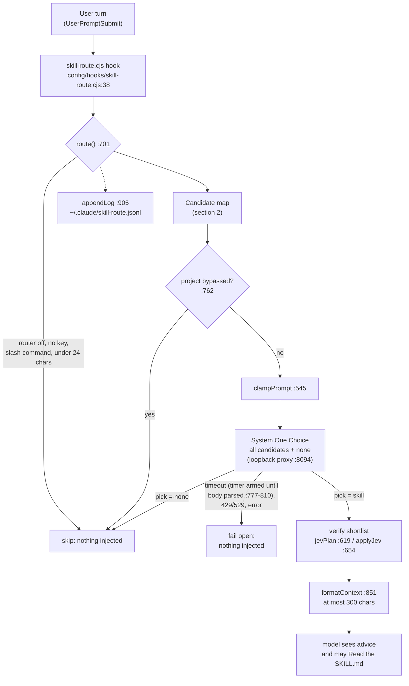
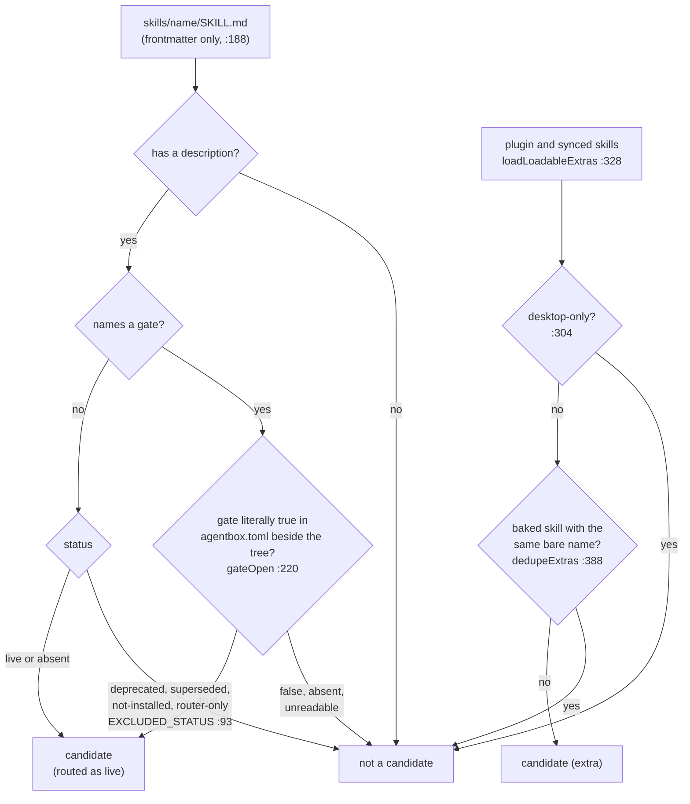
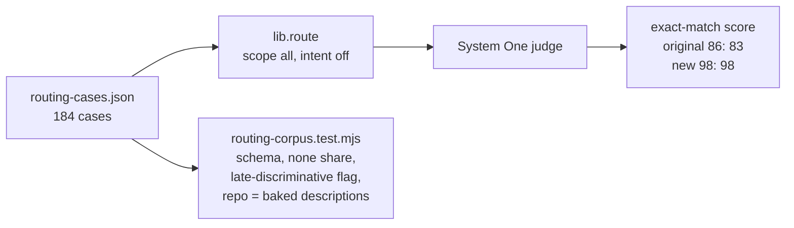

# Skill Selection Diagrams

How a user turn becomes a skill recommendation, and which skills are allowed to be candidates.
References are to `config/hooks/lib/skill-route.cjs` unless noted, at the revision this file was
last edited with (2026-11-11, ADR-2196). Decisions: ADR-2091 (the live router), ADR-2192 (scope
`all`), ADR-2196 (gates, no half-installed skills).

---

## 1. Flow: one user turn through the routing hook

The entrypoint registers `config/hooks/skill-route.cjs` on `UserPromptSubmit` with an 8 s timeout
(`config/entrypoint-unified.sh:2767`), with the `[skills.routing]` settings inlined as environment
variables. The hook calls `route()` (`:701`) once per turn, logs the outcome (`appendLog`, `:905`;
metadata only, never the prompt) and injects at most 300 characters of advice
(`formatContext`, `:851`; `MAX_CONTEXT_CHARS`, `:54`). It never loads a skill itself: the model
decides.

`skill_intent` is off (`agentbox.toml`, `[system_one.consumers]`), which halves each turn's input
for identical picks (measured 2026-11-11); `skill_verify` stays on
(`services/agentbox-manifest/src/system_one.rs:476-480`).

## 2. Flow: which skills may be candidates

`loadCandidates` (`:235`) reads every `skills/<name>/SKILL.md` in the baked tree
(`/opt/agentbox/skills`), using only the leading frontmatter block (`frontmatterBlock`, `:188`).
Extras come from enabled plugins and account-synced skills (`loadLoadableExtras`, `:328`), minus
those that need the Claude desktop app (`DESKTOP_ONLY_SYNCED`, `:304`), and a baked skill always
beats an extra of the same bare name (`dedupeExtras`, `:388`).

Since ADR-2196 no skill in the tree carries `not-installed` or `superseded`: a skill whose tool is
missing is either baked (semgrep, gitleaks, trivy, jj) or deleted. `router-only` remains for index
skills that sit behind another (`skill-router`, `browser-automation`), and `gate:` is the only way
to ship a skill that is deliberately off (`payment-router`, gate off; `voyager-skill-library`,
gate on).

## 3. How accuracy is measured

The labelled corpus is `tests/system-one/routing-cases.json` (184 cases; the original 86 are the
regression gate, the 98 added on 2026-11-11 were co-written with the descriptions they score). It
is scored through `lib.route` itself, not through `skills/system-one/scripts/route-eval.mjs`,
whose instrument has no `none` option and no plugin or synced extras. Two identical runs differ by
about one case, so a change of one case is noise.

The last assertion in `tests/system-one/routing-corpus.test.mjs` (repo descriptions equal the
baked ones) fails inside a running container after any description edit until the next rebuild;
CI has no baked tree and skips it.
