# RA-ledgers: decision-ledger audit across the DreamLab estate

Scope: agentbox (`docs/adr`), VisionClaw host (`project/docs/adr`), VisionFlow canon
(`VisionFlow/docs/adr` + `docs/estate-review` + `docs/dream-cycle/LEDGER.md`),
nostr-rust-forum (`docs/adr`), solid-pod-rs (`crates/solid-pod-rs/docs/adr`), plus
agentbox `docs/proposals/` (PRD-023, PRD-024, colloquy, upstream-cq) and host
`docs/TODO-unified.md` / `docs/KNOWN_ISSUES.md`. Run 2026-09-21. Axes are the ledgers'
own `decision | implementation | activation` triple (README columns), not my
judgement. "Code cites it" is a literal `grep -rl "ADR-NNNN"` over source, excluding
`docs/`; a hit only proves a comment references the record, not that the record's
substance is implemented — treat it as a lower bound on traceability, not a
correctness signal.

**Compression note.** Because the 2026-08-31 consolidation re-dated almost every
surviving record across every repo (agentbox ADR-2001 itself carries that date), "dated
2026-08-31 or later" is not a useful filter on its own — it is nearly the whole corpus
(98/103 agentbox, 103/108 host, 12/12 VisionFlow, 12/12 forum, 8/8 solid-pod-rs). Table 1
below therefore lists every record in that window that is **not** `accepted / complete /
live` (i.e. everything still owed some work), and gives the fully-closed remainder as a
per-repo count. That is the honest way to show "every record" inside a 700-line budget
without burying the 70-odd records that actually need something from someone.

---

## 1. Every non-closed ledger record dated 2026-08-31 or later

Columns: decision / impl / activation are the ledger's own axes. "Code" = number of
non-doc source files that name the ADR ID (`—` not checked, `0` checked and empty).
Age is against 2026-09-21.

### 1a. agentbox (`docs/adr/README.md`) — 98 in window, 28 fully closed (accepted/complete/live), 70 below

| ID | Date | Decision | Impl | Activation | Code | Note |
|---|---|---|---|---|---|---|
| ADR-2001 | 08-31 | accepted | partial | staged | — | corpus consolidation itself, still staged |
| ADR-2004 | 08-31 | accepted | partial | live | — | five adapter slots |
| ADR-2005 | 08-31 | **superseded** | partial | live | — | dispatch middleware order |
| ADR-2008 | 08-31 | accepted | partial | live | — | MCP projector reconcile |
| ADR-2012 | 08-31 | accepted | partial | live | — | relay allowlist-only ingress |
| ADR-2013 | 08-31 | accepted | partial | live | — | loopback publish except :9096 |
| ADR-2014 | 08-31 | accepted | partial | live | — | memory MCP-only fail-closed |
| ADR-2015 | 08-31 | accepted | partial | live | — | trajectory recorder |
| ADR-2017 | 08-31 | accepted | partial | live | — | consumer behind producer (W066) |
| ADR-2019 | 08-31 | accepted | **none** | inactive | — | 384-dim model-lifecycle freeze — accepted 3 weeks, zero code |
| ADR-2020 | 08-31 | accepted | partial | live | — | capability gating |
| ADR-2021 | 08-31 | accepted | partial | live | — | skills JIT context lint |
| ADR-2022 | 08-31 | accepted | partial | live | — | governed ontology writes |
| ADR-2023 | 08-31 | accepted | partial | live | — | Loom façade |
| ADR-2024 | 08-31 | accepted | partial | live | — | dream-cycle gating |
| ADR-2025 | 08-31 | proposed | partial | inactive | — | cross-repo federation contract |
| ADR-2026 | 08-31 | proposed | partial | inactive | — | session-mirror egress boundary |
| ADR-2027 | 08-31 | proposed | **none** | inactive | 0 | secret custody/rotation/break-glass — proposed, no code |
| ADR-2028 | 09-02 | proposed | partial | staged | — | vault manifest path authority |
| ADR-2029 | 09-02 | proposed | complete | staged | — | Rune notes window — built, not activated |
| ADR-2030 | 09-03 | accepted | partial | live | — | permissive licensing for publishable crates |
| ADR-2031 | 09-04 | accepted | complete | staged | — | consultant model manifest projection |
| ADR-2032 | 09-04 | accepted | partial | staged | — | daemon identification argv boundaries |
| ADR-2033 | 09-05 | accepted | partial | staged | — | deepsec security gate |
| ADR-2034 | 09-05 | accepted | partial | staged | — | resource-topology hook shim / MCP hub |
| ADR-2040 | 09-05 | accepted | partial | staged | — | no unauthenticated supervised listener |
| ADR-2041 | 09-05 | accepted | partial | live | — | wire execution journal / action pipeline |
| ADR-2054 | 09-05 | accepted | partial | live | — | every ontology-authoring caller crosses the gate |
| ADR-2055 | 09-05 | accepted | partial | live | — | baseline mustn't conflate privacy filter with Loom |
| ADR-2057 | 09-05 | accepted | complete | staged | — | close the capability-gate gaps |
| ADR-2059 | 09-05 | proposed | **none** | inactive | 0 | reasoner preflight on email gateway |
| ADR-2060 | 09-05 | proposed | **none** | inactive | 0 | cross-store erasure reverse tombstone |
| ADR-2063 | 09-05 | accepted | complete | staged | — | interaction-plane post-rebuild fixes |
| ADR-2064 | 09-05 | accepted | complete | staged | — | pod-request signing fails closed |
| ADR-2065 | 09-05 | accepted | complete | staged | — | one writer for the pod inbox |
| ADR-2066 | 09-05 | accepted | partial | **inactive** | — | pod signing-key path reachable — accepted+partial but inactive |
| ADR-2068 | 09-05 | accepted | complete | staged | — | root session runs its gated hooks |
| ADR-2071 | 09-05 | proposed | **none** | inactive | 0 | journal the nightly dream cycle |
| ADR-2072 | 09-05 | accepted | complete | staged | — | briefing workflow route surface |
| ADR-2073 | 09-05 | proposed | **none** | inactive | 0 | Loom asserted/inferred graph isolation |
| ADR-2074 | 09-05 | proposed | **none** | inactive | 0 | deferred-distillation MCP server (amends ADR-051) |
| ADR-2075 | 09-05 | proposed | partial | inactive | — | Loom-attested generation identity |
| ADR-2076 | 09-05 | proposed | **none** | inactive | 0 | benchmark the agent retrieval path |
| ADR-2077 | 09-05 | proposed | **none** | inactive | 0 | prove byte-identical-when-off by rebuild |
| ADR-2078 | 09-05 | proposed | **none** | inactive | 0 | provision pods signer from sovereign identity |
| ADR-2079 | 09-06 | proposed | **none** | inactive | 0 | AoE as dispatch plane of a fleet model router |
| ADR-2080 | 09-06 | accepted | partial | staged | — | metaharness router console under AoE |
| ADR-2081 | 09-07 | accepted | complete | staged | — | annexe depth law / honest evaluator receipts |
| ADR-2082 | 09-07 | accepted | complete | staged | — | orchestration proxy behind governed memory server |
| ADR-2083 | 09-09 | accepted | partial | staged | 1 | skills estate authoring contract |
| ADR-2085 | 09-13 | proposed | partial | **inactive** | 9 | colloquy knowledge units on the forum |
| ADR-2086 | 09-13 | proposed | complete | staged | 5 | confirmation weight follows authorising principals |
| ADR-2087 | 09-14 | accepted | complete | **inactive** | 6 | task-property receipts/manual continuation — built, not switched on |
| ADR-2088 | 09-15 | proposed | complete | **inactive** | 7 | grill before acting on forum suggestions |
| ADR-2090 | 09-16 | accepted | **none** | inactive | 7 | skill-routing prompt egress (deliberately deferred, per record) |
| ADR-2091 | 09-16 | accepted | complete | staged | 10 | live skill router |
| ADR-2092 | 09-16 | accepted | complete | staged | 1 | govern agent/command registries |
| ADR-2093 | 09-18 | accepted | complete | staged | 7 | Jev verbatim compaction |
| ADR-2094 | 09-20 | accepted | partial | **inactive** | 8 | local capacity-adapting typed-decision façade (PRD-023) |
| ADR-2095 | 09-21 | accepted | partial | staged | 0 | measure typed-decision seams vs copy ceiling — 0 code hits same day |
| ADR-2096..2103 | 09-21 | proposed ×8 | **none** ×8 | inactive ×8 | 0 | sovereign settlement pack (PRD-024), see §4 |

### 1b. VisionClaw host (`project/docs/adr/README.md`) — 103 in window, 63 closed, 40 below

15 of these are flagged **STALE** by `node scripts/adr-index-gen.js docs/adr --check`
(§2) — marked with `*`.

| ID | Date | Decision | Impl | Activation | Code | Note |
|---|---|---|---|---|---|---|
| ADR-2001 | 08-31 | accepted | partial | staged | — | corpus consolidation |
| ADR-2002* | 08-31 | accepted | complete | live | — | NIP-98 single-use replay cache — STALE vs SECURITY-profiles.md |
| ADR-2004* | 08-31 | accepted | complete | live | — | Oxigraph SQLite persistence — STALE vs Cargo.toml/app_state.rs |
| ADR-2005 | 08-31 | accepted | partial | live | — | hexagonal crate split |
| ADR-2005* | 08-31 | accepted | partial | live | — | (same file also flagged stale vs actor renames) |
| ADR-2006 | 08-31 | accepted | partial | live | — | ACSP human approval |
| ADR-2007 | 08-31 | accepted | partial | live | — | GPU coordinator supervisors |
| ADR-2008* | 08-31 | accepted | partial | live | — | dev image recompiles — STALE vs compose/entrypoint |
| ADR-2010 | 08-31 | accepted | partial | live | — | RBAC lattice atomic mutations |
| ADR-2012 | 08-31 | accepted | partial | live | — | dev-bypass triple-gated |
| ADR-2013 | 08-31 | accepted | **none** | inactive | — | federation delegation deferred |
| ADR-2016 | 08-31 | accepted | partial | live | — | provenance append-only |
| ADR-2017 | 08-31 | accepted | partial | live | — | write-master backup posture |
| ADR-2018* | 08-31 | — | — | — | frozen 52-byte v3/v5 envelope — STALE vs binary_protocol.rs (both crates) |
| ADR-2019* | 08-31 | — | — | — | tag-byte registry governed dispatch — STALE, same files |
| ADR-2020 | 08-31 | accepted | complete | staged | — | agent copresence sibling opcode |
| ADR-2021 | 08-31 | accepted | partial | live | — | typed URN mint/parse dual |
| ADR-2024* | — | — | — | — | wire node-id 26-bit — STALE vs binary_protocol.rs |
| ADR-2026* | — | — | — | — | fail-closed security posture — STALE vs main.rs |
| ADR-2027 | 08-31 | accepted | partial | live | — | three deployment profiles |
| ADR-2027* | — | — | — | — | (same file, STALE vs compose/main.rs) |
| ADR-2029 | 08-31 | accepted | partial | live | — | force-channel flag derivation |
| ADR-2030 | 08-31 | accepted | partial | live | — | PTX ISA downgrade |
| ADR-2030* | — | — | — | — | STALE vs `crates/visionclaw-gpu/build.rs` |
| ADR-2031 | 08-31 | **rejected** | none | inactive | — | withdrawn/reserved slot |
| ADR-2033 | 08-31 | accepted | partial | live | — | HUD buttons fire on press |
| ADR-2034 | 08-31 | accepted | partial | live | — | RenderStore instance-math stride 16 |
| ADR-2037* | 08-31 | proposed | partial | staged | — | production build excludes dev-auth — STALE vs ci.yml/main.rs |
| ADR-2038* | 08-31 | accepted | partial | live | — | boot-time profile assertion — STALE vs main.rs |
| ADR-2039 | 09-01 | proposed | complete | **inactive** | — | VisionClaw dev-mode LAN-local bypass |
| ADR-2040 | 09-02 | proposed | partial | staged | — | Obsidian vault frontmatter gate |
| ADR-2041 | 09-02 | proposed | complete | staged | — | graph-settings key knowledge |
| ADR-2042 | 09-02 | proposed | partial | live | — | vault-migrate converter |
| ADR-2043 | 09-05 | accepted | complete | staged | — | reject full-disclosure flag pair at boot |
| ADR-2049 | 09-05 | accepted | complete | staged | — | production image build must be able to fail |
| ADR-2061 | 09-05 | accepted | complete | staged | — | validate analytics kernels against oracle |
| ADR-2071 | 09-05 | accepted | complete | staged | — | consolidate inferred-edge materialisation |
| ADR-2084 | 09-05 | accepted | complete | staged | 1 | 9500 load-bearing doc correction / WS cutover plan |
| ADR-2085 | 09-05 | accepted | complete | staged | 1 | briefing workflow server route gap |
| ADR-2101 | 09-05 | accepted | complete | staged | 1 | durable decision-elevation case state |
| ADR-2102 | 09-05 | proposed | **none** | inactive | — | estate-wide cross-store erasure orchestration |
| ADR-2103 | 09-05 | proposed | **none** | inactive | — | Oxigraph point-in-time backup |
| ADR-2104 | 09-05 | proposed | **none** | inactive | — | SOPS execute-or-withdraw |
| ADR-2105 | 09-05 | proposed | **none** | inactive | — | correlated promotion chain end-to-end |
| ADR-2106* | 09-06 | accepted | partial | live | 3 | ontology pull model into embedded pod — STALE vs main.rs |
| ADR-2107* | 09-07 | accepted | partial | staged | 0 | compatible XR visual experience — STALE vs hud.gd, 0 code hits |
| ADR-2108 | 09-08 | proposed | complete | staged | 1 | dev profile arms VisionClaw dev-mode by default |
| ADR-2109* | 09-09 | accepted | partial | staged | 1 | XR agent embodiment, single pose owner — STALE vs 2 .gd files |
| ADR-2110 | 09-15 | accepted | partial | **inactive** | 1 | augmentation conditions — VC clauses closed, `activation_status: inactive` (TODO-unified AC-VC-1) |
| ADR-2111 | 09-21 | proposed | **none** | inactive | 0 | re-sequence RGB for bridged assets, delete host payment store |

### 1c. VisionFlow canon (`docs/adr/README.md`) — 12/12 in window, 8 closed, 4 below

| ID | Date | Decision | Impl | Activation | Code | Note |
|---|---|---|---|---|---|---|
| ADR-2007 | 09-04 | proposed | partial | staged | — | estate closeout evidence roadmap |
| ADR-2010 | 09-14 | accepted | complete | staged | — | augmentation conditions = canon audit lens |
| ADR-2011 | 09-14 | accepted | complete | staged | — | task properties set the boundary |
| ADR-2012 | 09-21 | proposed | **none** | inactive | 0 | sidestr settlement is ecosystem canon |

### 1d. nostr-rust-forum (`docs/adr/README.md`) — 12/12 in window, 8 closed, 4 below

| ID | Date | Decision | Impl | Activation | Note |
|---|---|---|---|---|---|
| ADR-2002 | 08-31 | accepted | partial | staged | canary-first upstream nostr absorption |
| ADR-2010 | 09-04 | proposed | partial | **inactive** | durable governance outcome receipts |
| ADR-2011 | 09-14 | accepted | partial | **inactive** | operator task-properties set escalation boundary |
| ADR-2012 | 09-21 | proposed | **none** | inactive | D1 ledger becomes a chain view |

### 1e. solid-pod-rs (`crates/solid-pod-rs/docs/adr/README.md`) — 8/8 in window, 6 closed, 2 below

| ID | Date | Decision | Impl | Activation | Note |
|---|---|---|---|---|---|
| ADR-2006 | 08-31 | accepted | complete | **staged** | NIP-98/ReplayStore seam — the only record here not "live" |
| ADR-2008 | 09-21 | proposed | **none** | inactive | port bitcoin_tx.rs to rust-bitcoin; WebLedger becomes chain view |

---

## 2. Index-generator `--check` results (staleness gate)

Ran each repo's own generator, exactly as the ledgers require after governed paths
change.

- **agentbox** (`node scripts/adr-index-gen.js docs/adr --check`): **2 stale** —
  ADR-2009 (`nip98-proxy-identity-boundary`) and ADR-2010 (`bearer-gated-behind-nip98`),
  both against `docs/INGRESS-identity.md` re-verified since `verified_commit
  b680a7aeef60...`.
- **VisionClaw host** (`node scripts/adr-index-gen.js docs/adr --check`): **15 stale**
  (exactly the count the brief asked me to verify). Drift is concentrated in the binary
  wire protocol and boot/deploy surface, i.e. code that keeps moving under settled
  decisions rather than decisions being wrong:
  - ADR-2002 vs `docs/SECURITY-profiles.md`
  - ADR-2004 vs `Cargo.toml`, `src/app_state.rs`
  - ADR-2005 vs `Cargo.toml`, `src/actors/decision_elevation_actor.rs`,
    `src/actors/elevation_actor.rs`, `src/actors/voice_interface_actor.rs`
  - ADR-2008 vs `docker-compose.unified.yml`, `scripts/dev-entrypoint.sh`
  - ADR-2018, ADR-2019 vs `src/utils/binary_protocol.rs`,
    `xr-client/rust/src/binary_protocol.rs` (both amend the same wire file — one
    underlying drift, two stale records)
  - ADR-2024 vs `src/utils/binary_protocol.rs`
  - ADR-2026, ADR-2038 vs `src/main.rs`
  - ADR-2027 vs `docker-compose.unified.yml`, `src/main.rs`
  - ADR-2030 vs `crates/visionclaw-gpu/build.rs`
  - ADR-2037 vs `.github/workflows/ci.yml`, `src/main.rs`
  - ADR-2106 vs `src/main.rs`
  - ADR-2107 vs `xr-client/scripts/hud.gd`
  - ADR-2109 vs `xr-client/scripts/agent_demo_director.gd`,
    `xr-client/scripts/graph_scene.gd`
  Six of the fifteen amend `src/main.rs` alone — that file has drifted under more
  settled decisions than any other in the estate.
- **VisionFlow** (`scripts/adr-index-gen.cjs docs/adr --check`): clean, 12/12 valid.
- **nostr-rust-forum** (`scripts/adr-index-gen.js docs/adr --check`): clean, 12/12
  valid.
- **solid-pod-rs** (`scripts/adr-index-gen.js crates/solid-pod-rs/docs/adr --check`):
  clean, 8/8 valid.

The three smaller repos are clean; the two repos with the most day-to-day code churn
(agentbox, host) are the only ones accumulating staleness, and the host's 15 outnumber
agentbox's 2 by 7.5x — the host ledger is the one that needs a re-verify pass before
anything else in it is trusted at face value.

---

## 3. Programme clusters

For each: last activity, state, what finishes it, what depends on it.

**AoE interaction plane (PRD-021, agentbox ADR-2079/2080)** — last activity 09-06.
State: **partial/live** for the core (`aoe serve` on :9095 behind NIP-98 :9096, per
`agentbox/CLAUDE.md`), but the fleet-router framing (ADR-2079, proposed/none) and the
metaharness console (ADR-2080, accepted/partial/staged) are still open. Finishes when
ADR-2079's dispatch-plane question is answered and the router console activates.
Depends on: sovereign identity (pods signer, ADR-2078, proposed/none — session identity
binding at create needs this), AoE task properties (ADR-2087, built but inactive).
Blocks: skills/agent registries which route through it, and part of PRD-023 (the
typed-decision façade sits behind AoE sessions).

**Semantic integrity / erasure (PRD-022 lineage, ADR-2060, ADR-2102 host, ADR-2103
host/agentbox, host ADR-2104/2105)** — last activity 09-05, **frozen since**. State:
proposed/none/inactive across the board on both sides of the boundary — agentbox's
reverse tombstone (ADR-2060) and the host's cross-store orchestrator (ADR-2102) are two
halves of one capability, neither started. TODO-unified's EA-06/G-7 rows corroborate:
"no private data was erased or restored." Finishes when one of the two repos lands a
concrete per-store subject/authority mapping; the other's ADR references it. Blocks:
any credible GDPR/right-to-erasure claim for the estate, and DATA-authority-erasure's
own Invariants (the governing doc that ADR-2102 is supposed to update remains
unamended).

**Skills/agents/commands governance (ADR-2083, 2089-2093)** — last activity 09-18.
State: **largely complete and live** — this is the one programme in the whole audit
that ran start to finish inside two weeks (skills contract → status field → live router
→ agent/command registries → Jev compaction), each ADR citing 1-10 code files. The one
loose end is ADR-2090 (skill-routing prompt egress) at accepted/none/inactive — the
record itself says per-project gates are "deferred, not waived," so this is a
deliberately parked follow-on, not drift.

**Agent/command registry (ADR-2092)** — subsumed into the cluster above; complete/staged,
1 code hit (the reconcile script). Depends on nothing new; blocks nothing — closed leaf.

**Typed decisions / Sovereign System One (PRD-023, ADR-2089/2090/2091/2093 → ADR-2094 →
ADR-2095)** — last activity 09-21 (today). State: **partial, chasing itself** — ADR-2094
(façade) landed 09-20 as accepted/partial/inactive, and ADR-2095 (the measurement gate
that should validate it) landed the very next day, also not yet activated (0 code hits
same-day). PRD-023's own `review_trigger` is "the first measured accuracy/latency run
... against the ADR-2089 baseline" — that run has not happened. This is the pattern the
owner is worried about: a decision, then a decision about how to measure the decision,
before the first decision is switched on. Depends on: ADR-2089 baseline (closed),
ADR-2084 (Loom client, closed). Blocks: nothing yet outside itself — it is not gating
other programmes, which makes it a safe place to pause rather than a bottleneck.

**Sovereign settlement (PRD-024, agentbox ADR-2096-2103, host ADR-2111, VisionFlow
ADR-2012, forum ADR-2012, solid-pod-rs ADR-2008)** — last activity 09-21 (today, all
twelve records same day). State: **proposed/none/inactive, unanimously, across five
repos**. This is the largest single-day intake in the whole audit: eight new agentbox
ADRs plus one amending record in each of the other four repos, all citing zero code, all
explicitly superseding prior *settled* decisions (PRD-015's Lightning rail, ADR-032's
"settlement is Lightning-first," ADR-124's bridged-asset sequencing, and a 2026-09-02
anchoring note). PRD-024 itself is honest about its own status: "scope / pre-ratification
(not authority)... every decision here is minted proposed; the owner ratifies." Depends
on: ADR-2078 (pods signer, itself proposed/none), ADR-2085/2086/2087 (colloquy +
task-property receipts, partially built). Blocks: nothing is yet built on top of it — but
it **reopens** three previously-closed decisions across two repos, which is the
clearest single example of "getting lost in side quests" in the ledger set (see §4).

**Loom/connector (ADR-2084 one published loom-client)** — closed, complete/live, cited
from three consumer crates per `agentbox/CLAUDE.md`. No further work; a genuine finished
leaf that later programmes (settlement, explainer) build on safely.

**Colloquy / forum learning surface (proposal 09-13, ADR-2085/2086/2088)** — last
activity 09-15. State: mixed — ADR-2086 (confirmation weight) is proposed/complete/staged
with 5 code hits (built ahead of ratification); ADR-2085 (the knowledge units themselves)
is proposed/partial/inactive with 9 hits; ADR-2088 (grill-before-acting) is
proposed/complete/inactive with 7 hits. Three records, three different activation states,
none live. Finishes when the owner ratifies the underlying colloquy proposal itself
(status: "scope / pre-ratification"), which none of the three ADRs can do on their own.
Depends on: the published `colloquy-core`/`colloquy-store`/`colloquy-nostr` crates
(closed per agentbox/CLAUDE.md). Blocks: PRD-024's settlement pack lists ADR-2085/2086/
2087 as dependencies, so settlement is partly gated on ratifying this first.

**Agent registry (ADR-2092)** — see skills cluster; closed.

**XR (host ADR-2107/2108/2109/2110, VisionFlow ADR-2010/2011)** — last activity 09-15
(host ADR-2110). State: partial/mixed, three of four host records STALE (§2). ADR-2110
(augmentation conditions) is the most consequential: TODO-unified's AC-VC-1/AC-VC-2 rows
say the VisionClaw clauses passed 1408 lib tests + 23 client tests, deepsec clean, but
`activation_status: inactive` — deliberately not deployed. AC-FORUM-1 is explicitly
**blocked**, waiting on the forum/agentbox halves of the same evidence files. Depends
on: rationale-gate enforcement (closed), forum FR3 `effective_tier` (not started).
Blocks: nothing else in this audit; it is a leaf that's functionally done and
intentionally held back.

**Dream cycle (agentbox ADR-2071/2024, VisionFlow ADR-2008/2009, LEDGER.md)** — last
activity 09-13 (VisionFlow LEDGER). State: live but narrow — the nightly cycle only
watches a static marketing site (content-integrity/build-pipeline/seo-and-meta rotation);
webgl-mesh was parked sidecar-only (ADR-2009) after four INCONCLUSIVE nights found no
browser runner to evaluate it; estate-health was added then demoted to advisory after it
vetoed six unrelated nights (09-07 operator note). Meanwhile agentbox's own
"journal the nightly dream cycle" (ADR-2071) sits proposed/none since 09-05 — the cycle
that watches the *website* has three governing ADRs and a live ledger; the cycle
infrastructure itself has none. Depends on: nothing blocking. Blocks: nothing else
audited here, but it is the clearest case of a subsystem accreting its own governance
(2008, 2009) faster than the thing it's supposed to journal (2071) gets journaled.

**Deployment/dev profile (host ADR-2037-2039, ADR-2043, ADR-2049, ADR-2108)** — last
activity 09-08. State: mostly complete/live, but ADR-2037 and ADR-2038 are both STALE
(§2) and ADR-2108 (dev profile arms dev-mode by default) is proposed/complete/staged —
built, cited once, not yet ratified. Low risk: security-relevant but small blast radius,
and the CI gate (ADR-2086 host) already enforces the invariant these records describe.

---

## 4. Dependency graph (programmes blocking programmes)

```mermaid
graph TD
  AoE[AoE interaction plane<br/>PRD-021 partial/live]
  Semantic[Semantic integrity / erasure<br/>frozen since 09-05]
  Skills[Skills/agents/commands governance<br/>complete]
  Typed[Typed decisions / SSO<br/>PRD-023 chasing itself]
  Settlement[Sovereign settlement<br/>PRD-024 proposed x12, today]
  Colloquy[Colloquy forum learning<br/>pre-ratification]
  Loom[Loom/connector<br/>closed]
  XR[XR embodiment<br/>done, held inactive]
  Dream[Dream cycle<br/>live, narrow scope]
  Deploy[Deployment/dev profile<br/>mostly live, 2 stale]
  PodsSigner[Pods signer from sovereign identity<br/>ADR-2078 proposed/none]

  Loom --> Typed
  Skills --> AoE
  AoE --> Typed
  PodsSigner --> AoE
  PodsSigner --> Settlement
  Colloquy --> Settlement
  Typed -.chasing self.-> Typed
  Semantic -.blocks.-> Settlement
  Settlement -.reopens.-> PriorSettled[PRD-015 Lightning rail<br/>ADR-032, ADR-124<br/>previously settled]
  XR -.independent, held.-> Settlement
  Dream -.unrelated track.-> Settlement

  style Settlement fill:#5a2020
  style Semantic fill:#5a2020
  style Typed fill:#5a4a20
  style PriorSettled fill:#333
```

Reading it: **PodsSigner (ADR-2078) is the one node with two outgoing edges into
in-flight programmes** — AoE session identity binding and the settlement pack's
federation both cite it as a dependency, and it has sat at proposed/none since 09-05.
Semantic integrity/erasure is drawn as blocking settlement because RGB asset bridging
(ADR-2102 agentbox) and cross-store erasure (ADR-2102 host) both touch the same
data-authority surface; neither is built, so settlement's asset-bridging half has no
foundation to land on even once ratified.

---

## 5. Side-quest evidence

The owner's read is corroborated by four distinct patterns, not one:

1. **A decision about measuring a decision, before the decision ships.** ADR-2094
   (façade) 09-20 → ADR-2095 (measure the façade against a copy ceiling) 09-21, same
   author, same day-adjacent, ADR-2095 itself `partial/staged` with **zero code**
   citing it yet. The façade it's meant to measure is `partial/inactive`. Two ledger
   entries, no running façade to measure.

2. **Records that amend records that were never implemented.** ADR-2079 ("AoE is the
   dispatch plane of a fleet model router") is `proposed/none/inactive` since 09-06 and
   references ADR-2080's metaharness console, which is itself only `partial/staged`.
   ADR-2074 ("deferred-distillation MCP server") explicitly amends ADR-051, which per
   agentbox/CLAUDE.md is itself the record the Loom/RuvNet-brain grounding rests on —
   amending a foundation stone with a proposal that has zero code.

3. **Proposals that reopen settled decisions.** This is the sharpest case: PRD-024's own
   frontmatter lists `supersedes_in_part: [PRD-015 C10 Lightning rail, ADR-032 D5
   settlement is Lightning-first, ADR-124 P3 sequencing for the bridged-asset case, the
   2026-09-02 "anchoring stays on SHA-256d mainnet" note]`. Four previously-ratified
   positions, reopened in one document, landing eight new agentbox ADRs plus one each in
   four sibling repos, all in a single day, all still `proposed/none/inactive`. Contrast
   with the skills-governance cluster (§3), which took the same two weeks to go from
   proposal to five closed, live ADRs. The settlement pack is documentation velocity
   without implementation velocity — twelve ledger entries with a combined code
   footprint of zero.

4. **Governance of a thing outrunning the thing.** The dream cycle has two governing
   ADRs about *how to run it* (VisionFlow ADR-2008 estate-health collection, ADR-2009
   webgl-mesh parking) while agentbox's own "journal the nightly dream cycle" (ADR-2071)
   — the record that would make the cycle's own history auditable — has sat
   proposed/none since 09-05. The mechanism got more attention than the log of what the
   mechanism did.

None of this means the settlement pack is wrong — PRD-024 is explicit that it is
"scope, not authority," and a four-Sonnet/three-Opus research mesh audited it before
writing (per the PRD's own §"Research basis"). The side-quest signal isn't the content;
it's the **rate**: twelve proposed records in a day against a typed-decision programme
still not activated, and an erasure programme untouched for sixteen days.

---

## 6. Proposed-but-unbuilt decisions per repo (decision = proposed, impl = none)

| Repo | Count | IDs |
|---|---|---|
| agentbox | **18** | ADR-2027, 2059, 2060, 2071, 2073, 2074, 2076, 2077, 2078, 2079, 2096, 2097, 2098, 2099, 2100, 2101, 2102, 2103 |
| VisionClaw host | **4** | ADR-2102, 2103, 2104, 2105 |
| VisionFlow | **1** | ADR-2012 |
| nostr-rust-forum | **1** | ADR-2012 |
| solid-pod-rs | **1** | ADR-2008 |
| **Total** | **25** | |

Ten of the eighteen agentbox rows (2096-2103, plus 2078 as dependency) and all four host
rows plus the three sibling-repo rows belong to the two frozen/in-flight clusters
above (settlement, erasure) — meaning **17 of 25** proposed-but-unbuilt decisions across
the whole estate sit inside just two programmes.

---

## 7. Three candidates for "the one thing that unblocks the most"

Argued from the graph in §4, not from taste:

**1. Ratify and implement ADR-2078 (provision the pods signer from sovereign
identity).** It is the only node in §4's graph with edges into two separately-active
programmes: AoE session identity binding (PRD-021, live but session-create identity
still deferred per `sign_requests = false`, ADR-2064) and the settlement federation
(PRD-024 ADR-2101, federation topology and key separation, which needs a real signer to
mean anything). It has been proposed/none since 09-05 — sixteen days stalled — and
`agentbox/CLAUDE.md` already documents the fail-closed shape (`SigningUnavailable`) so
the interface contract exists; only the wiring is missing. Unblocking it lets AoE close
its last open identity gap and gives the settlement pack something real to sign against
instead of a proposal.

**2. Finish one half of the semantic-integrity/erasure pair (ADR-2060 agentbox +
ADR-2102 host) rather than starting the settlement pack's asset-bridging half.** Both
sides have sat proposed/none since 09-05 — the single longest-frozen pair in the audit —
and TODO-unified's own EA-06/G-7 rows independently confirm no private data has actually
been erased or restored anywhere in the estate. This is a compliance-shaped gap
(DATA-authority-erasure's Invariants are supposed to be the compliance surface, and
they're currently describing an unbuilt mechanism), and it sits underneath the
settlement pack's asset-bridging clauses (ADR-2102 agentbox, RGB wrapping) without
either side noticing the shared foundation is missing.

**3. Run the first ADR-2095 measurement against the ADR-2094 façade before writing any
more typed-decision or settlement ADRs.** PRD-023's own `review_trigger` names this
exact run as the thing that should happen next, and it hasn't. It costs nothing new to
build — the façade (partial) and the measurement gate (partial, staged) both exist — and
it is the fastest way to convert one frozen "chasing itself" programme into either a
closed leaf or a falsified hypothesis, either of which is more useful than the current
state of two adjacent proposed records with no evidence between them. Doing this first
also tests, cheaply, whether the estate's newest governance instinct — measure-before-
ratify — actually produces a decision, before the same instinct is applied at PRD-024's
much larger scale.

---

## Sources consulted

- `agentbox/docs/adr/README.md`, `agentbox/scripts/adr-index-gen.js --check`
- `project/docs/adr/README.md`, `project/scripts/adr-index-gen.js --check`
- `VisionFlow/docs/adr/README.md`, `VisionFlow/scripts/adr-index-gen.cjs --check`,
  `VisionFlow/docs/dream-cycle/LEDGER.md`, `VisionFlow/docs/estate-review/`
- `nostr-rust-forum/docs/adr/README.md`, `nostr-rust-forum/scripts/adr-index-gen.js --check`
- `solid-pod-rs/crates/solid-pod-rs/docs/adr/README.md`,
  `solid-pod-rs/scripts/adr-index-gen.js --check`
- `agentbox/docs/proposals/{sovereign-settlement,sovereign-settlement-domain,
  sovereign-system-one,colloquy-forum-learning-surface,upstream-cq-contribution}.md`
- `project/docs/TODO-unified.md`, `project/docs/KNOWN_ISSUES.md`
- `agentbox/CLAUDE.md`, `project/CLAUDE.md` (for cross-checking claimed activation state)
- `grep -rl "ADR-NNNN"` per-record source citation counts, all five repos
