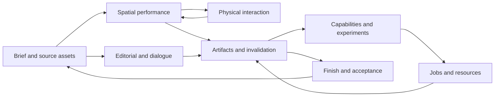
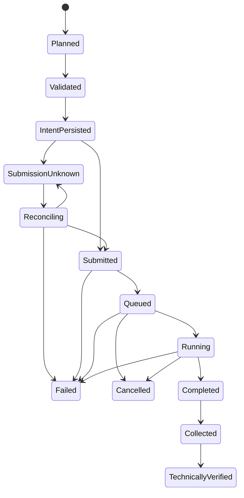
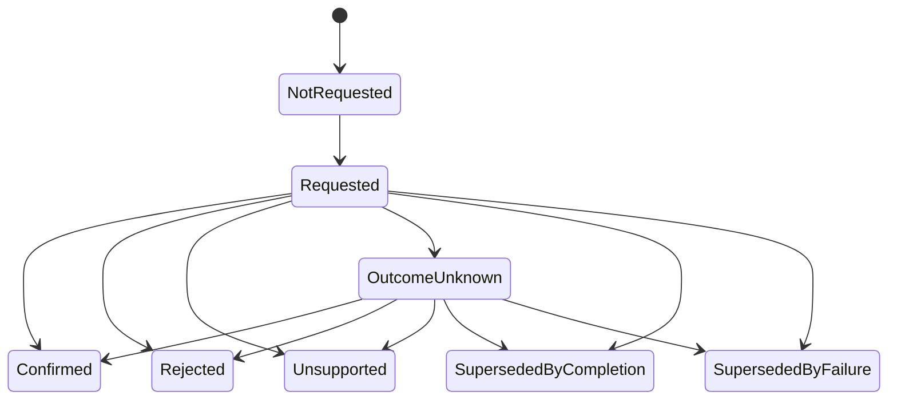

# Domain design: controlled, revisable video production

This defines the target domain model, not the state of the prototype implementation.
Use [implementation](implementation.md) for what exists and what must be written.
The [machine-readable design contract](contracts.json) provides requirement,
expectation, task and gate traceability. Native scene files and model graphs remain
external typed artifacts rather than being copied into the domain as arbitrary JSON.

## Ubiquitous language

| Term | Meaning and distinction |
| --- | --- |
| Production | One brief, asset authorities, delivery contract, revision history and release lineage |
| Beat | Narrative/action intent; not necessarily a shot, model job or equal duration |
| Shot/view | A camera/editorial interval derived from shared action, or an explicitly declared montage view |
| World revision | Versioned native visual state plus external semantic graph and scoped observations |
| Action revision | Authored trajectories, pose/exposure, contacts and events on a continuous action clock |
| Edit revision | Ordered delivery intervals and source mappings; never an implicit reassignment of the action clock |
| Source footage / source clip | Original recorded media with its decoded clock and streams / a versioned selected interval or derivative of that media; neither implies a native world |
| Identity reference | Source-backed character/prop/style appearance; does not prescribe camera or pose unless declared |
| Spatial anchor | Image tied to a specific world/action/view/frame; different from an untimed appearance board |
| Ownership mask | Visible native surface ownership with coordinate and occlusion semantics |
| Generated segmentation | Region measured on output imagery; cannot be assumed equal to proxy ownership |
| Sampling mask / final alpha | Generation freedom versus bounded final pixel contribution; separate artifacts |
| Workflow bundle | Exact compatible model/encoder/VAE/adapter/sampler/node/preprocessing configuration |
| Candidate | An output under evaluation; execution completion does not make it selected or accepted |
| Scoped equivalence proof | Machine-checked claim that specified dependencies/intervals are unchanged; not a narrative waiver |
| Review release | Complete timed deliverable with declared evidence and unresolved issues; may be provisional |
| Accepted release | A review release whose required gates and authorised creative acceptance are satisfied |

## Bounded contexts and ownership

| Context | Aggregates it owns | Publishes / consumes | Boundary |
| --- | --- | --- | --- |
| Brief and assets | ProductionBrief, SourceAsset, IdentitySet | BriefRevised, AssetSuperseded; consumes approvals | Owns intent and source precedence, not native geometry |
| Spatial performance | WorldRevision, ActionRevision, ViewPlan | WorldObserved, ActionChanged, CameraChanged | Native adapters own actual geometry; domain owns stable semantics and revisions |
| Physical interaction | SimulationRequest, SimulationRun, ReplayProof | SolveCompleted, ReplayVerified, ContactRejected | Optional context; required interactions cannot be waived by an absent solver |
| Editorial and dialogue | EditRevision, DialogueTake, Alignment, PerformancePlan, MixPlan | TakeReplaced, EditChanged, PerformanceChanged | Separate rational clocks; keeps supplied recordings distinct from inferred mouth performance |
| Capability and experiments | CapabilitySnapshot, WorkflowBundle, ExperimentPlan, Qualification | BundleQualified, QualificationStale, CandidateSelected | Chooses suitable technology for a scope, never a universal winner |
| Jobs and resources | ExecutionRequest, ProviderJob, ResourceReservation | JobObserved, SubmissionAmbiguous, CancelConfirmed | Owns durable intent/ownership, not artistic acceptance |
| Artifacts and invalidation | ArtifactDescriptor, DependencyGraph, RevisionImpact | ArtifactCollected, DependencyInvalidated, CacheReused | Immutable content/provenance; typed dependency roles and reuse proofs |
| Finish and acceptance | RenderPlan, ReviewRelease, GateEvidence, AcceptanceDecision | ReleaseAssembled, GateFailed, ReleaseAccepted | Publishes complete reviewable output and honest status |

Shared kernel: IDs, schema versions, digest, rational time, units/coordinates,
intervals, artifact references and evidence envelopes. The kernel contains no
Comfy node IDs, camera names, character names or default750-frame edit.
Cross-context exchange uses immutable versioned records/events, not direct mutation
of another context's aggregate. A single-process implementation with a transactional
local store is sufficient initially; a distributed event bus is not a prerequisite.



## Aggregate invariants

**ProductionBrief** contains revision, desired deliverables, applicability rules,
required facts/graphics, actor/prop IDs, continuity intent, source precedence,
quality/compute/storage limits and external-provider authorisation references.
A new source can supersede an old one only through an explicit revision event.
Unknown casting, clean artwork or voice takes are recorded as unresolved inputs;
a provisional release can expose them without claiming final approval.

Production route is explicit per segment: native/world-based, source-footage,
generated or a declared composition. World/action IDs are required when a request
claims a native view, continuous authored action or a physical replay. They are
absent, with a typed footage binding, for a footage-only edit; do not invent empty
worlds, dummy actor IDs or a Blender dependency to satisfy a universal schema.
Mixed edits preserve each contributing source's lineage and its applicability.
Native/physics checks can be `NOT_APPLICABLE` for footage-only segments, with a
recorded route reason; source continuity, timing, artwork and final review remain
applicable. Footage intended to represent one real continuous event must still
preserve its declared source-time continuity and disclose editorial omissions.

**WorldRevision** references native scene bytes, semantic graph and observations.
Stable object IDs survive geometry revisions; units, handedness, axes and transform
convention are explicit. Observations bind world digest, action revision, camera,
frame and evaluated-object membership. Native bounds explicitly state projection
and visibility limits. A render cannot be labelled as a view of an unrelated world.
The world also references a sealed `NativeDependencyClosure`: the `.blend` digest
alone does not identify evaluated state when libraries, textures or caches are
external. The closure contract and cache refusal rules are specified below.

**ActionRevision** owns continuous trajectories/contact events and allowed authored
exceptions. Cuts do not reset state. Deliberate montage, hidden relocation or magic
must be labelled with affected entities and intervals. Camera planning may change
independently, but scene geometry/animation is revised when its path or contact is
infeasible. Parent and child transforms cannot be replaced by disconnected parts
merely to satisfy an image.

**EditRevision** is a gap-free, overlap-free partition of delivery time, except
explicitly modelled transitions whose mixing semantics are defined. Every source
range, padding policy and source-to-delivery conversion is explicit. Frame rate is
`RationalRate(numerator, denominator)`, positive and reduced. Durations and sample
positions use checked integer/rational arithmetic; floating point is reserved for
physical coordinates and measured metrics, with stated tolerances.

`DurationPolicy` records requested rational seconds and/or integer delivery frames,
the authoritative constraint, rounding rule, allowed error in rational seconds,
and the resulting count/duration. Exact frame count takes precedence only when
the brief/profile declares it authoritative; otherwise it cannot override an
approved duration. If both constraints are exact and incompatible at the selected
rate, validation fails until an explicit production revision resolves the conflict.
For duration-with-tolerance, compute `requested_seconds * delivery_rate` exactly,
then apply the declared floor, ceiling or nearest-with-ties-to-even rule once at
the specified boundary. Check the resulting duration against the approved
tolerance; there is no implicit one-frame waiver or silent rate relabelling.
Record boundary residuals and use cumulative rational positions when partitioning
segments so independent rounding cannot accumulate drift. Audio sample placement
has its own declared conversion/rounding and tolerance, checked against the same
edit timeline. No rounding policy authorises stretching approved audio, dropping
required content or changing a physical action's timing without invalidation.

**DialogueTake** references immutable audio bytes, transcript/source revision,
speaker routing, language, take status and timing policy. Alignment contains tool
revision, confidence and reviewed corrections. PerformancePlan is editable and
separate from audio. The system must not trim words, stretch approved audio or infer
a speaking character merely to fit a bucket without an explicit production decision.

**WorkflowBundle** identifies exact component hashes and compatibility proof,
input roles/buckets, local/external boundary and supported cancellation/recovery.
A filename or advertised family name cannot substitute for version compatibility.
A Qualification binds bundle+profile+fixture versions+hardware/runtime scope, with
expiry/requalification triggers and explicit failed criteria.

**ExecutionRequest / ProviderJob** bind immutable dependencies before a side effect.
A lost response cannot invent a second job or change the first request. Cancellation
is confirmed only through authoritative provider state. Ownership includes
production/request IDs and provider identity; shared queues are not owned wholesale.
Authoritative execution phase and cancellation intent/outcome are separate fields.
A cancellation request does not replace `Running` or `Queued` with an assumed
terminal state. Use an atomic provider operation scoped to the exact owned job
identity/generation. Never issue a provider-global interrupt on a shared instance:
a sole-owned-active-job snapshot, a second snapshot, or an advisory lock that other
clients ignore is insufficient. Without a scoped operation, cancellation is reported
unsupported; observe and reconcile the owned job instead of interrupting the shared
service.

**ReviewRelease** binds the full edit, all selected artifacts, source graphic layers,
audio/mix, delivery settings, review evidence and open issues. Check/gate status is
one of `PROPOSED`, `NOT_RUN`, `BLOCKED`, `PASS`, `FAIL`, `NOT_APPLICABLE`, matching
the quality specification. `PROPOSED` describes an unimplemented check; `NOT_RUN`
means an available check was not executed; `BLOCKED` identifies a missing required
capability or unresolved prerequisite. Missing/unknown observations are retained
with their reason and keep a dependent check `NOT_RUN` or `BLOCKED`; they are never
coerced to `PASS`. `NOT_APPLICABLE` requires an explicit route/profile reason.
Provider capability values such as supported/unsupported/unknown are a different
type, not aliases for gate verdicts. Accepted status requires `PASS` for every
applicable hard gate and an authorised AcceptanceDecision. A provisional release remains useful
and named as such. Promoting one shot triggers review of its neighbouring cuts and
the complete edit, not an isolated endpoint-only assertion.

## Core value objects and wire envelopes

- `ArtifactId` and `Digest { algorithm: sha256, value }`; use the existing trusted
  SHA library. Content hash identifies bytes, not their semantic correctness.
- `FrameInterval { start, end_exclusive, clock_id }`; empty intervals permitted only
  in explicitly optional events, never as a mandatory rendered shot.
- `TimeMap { from_clock, to_clock, segments, rounding, padding, trim }`; monotonic
  within a normal segment; reverse/hold/montage mappings must declare their kind.
- `DurationPolicy { requested_seconds, requested_frames, authoritative_constraint,
  rounding, tolerance_seconds, resolved_frames, resolved_seconds }`; values are
  rational/integer as appropriate and validated against the declared edit clock.
- `CoordinateSpace { units, handedness, up_axis, image_origin, normalisation,
  pixel_aspect, transform_convention }`; no implicit world/image conversion.
- `ArtifactRole`: source_reference, source_footage, source_clip, appearance_board, native_view, timed_anchor,
  native_depth, ownership, segmentation, sampling_mask, composite_alpha,
  recording, transcript, performance, graphic_source, generated_clip, native_clip,
  composite_plate, review_master, delivery_master.
- `SourceBinding`: `Native { world_revision, action_revision, view_id, frame_map,
  dependency_closure }` or `Footage { source_asset, selected_interval,
  source_clock, decoded_timestamp_map, stream_selection }`; compositions carry
  their contributing bindings. Variable-frame-rate footage preserves decoded
  timestamps until an explicitly recorded delivery conversion. A generated
  candidate binds its declared conditioning sources; native IDs are mandatory
  only for inputs that claim native-world lineage.
- `NativeDependencyClosure { native_asset, entries, resolver_version, closure_digest,
  completeness, sealed_at }`; each entry records owning native object/data block,
  logical location, resolved immutable artifact reference, role and applicable
  frame/time range. Completeness is `sealed` or `unresolved`, not inferred from
  whether the top-level native file hashes successfully.
- `EvidenceEnvelope { id, claim, scope, input_hashes, command_argv, timestamp,
  code_revision, environment_ref, raw_output_ref, observed_metrics, verdict,
  limitations, author, reviewer }`.
- `ModelBucket { width_alignment, height_alignment, frame_count_rule,
  accepted_rates, duration_limits }`; an adapter explains its rule, not the core.
- `ResourceBudget { reserve_bytes, temporary_peak_bytes, runtime_limit,
  candidate_limit, concurrency, spend_limit, external_scope }`; unknown estimates
  require explicit bounded planning rather than invented zero cost.

Example event (schema proposal; values deliberately synthetic):

```json
{
  "schema": "video.event/1",
  "id": "event-42",
  "type": "DialogueTakeReplaced",
  "production_id": "demo-conversation",
  "expected_revision": 7,
  "new_revision": 8,
  "old_take_id": "take-a",
  "new_take_id": "take-b",
  "performance_intervals": [{"start": 120, "end_exclusive": 168, "clock_id": "delivery"}],
  "source_recording_changed": true,
  "edit_timing_changed": false
}
```

Commands carry expected revision and an idempotency key for local intent handling.
Commit state changes and outbox events atomically. Provider idempotency is a separate
capability; a locally unique request key cannot manufacture remote exactly-once
semantics. Event consumers record event IDs and reject stale revision application.

## State machines



A transport observation failure leaves the authoritative phase unchanged and adds
an observation error; it is not the `Failed` transition. `Reconciling -> Failed`
requires authoritative terminal evidence. An unresolved unknown submission cannot
be automatically resubmitted. Technical verification then feeds a separate
candidate/release decision: reviewed, rejected, selected-provisionally or accepted.
A content artifact may be technically valid yet creatively rejected.

Cancellation is an orthogonal state machine; execution above continues while it
is requested, rejected, unsupported or unresolved:



Only an authoritative cancelled terminal observation produces `Confirmed` and
execution phase `Cancelled`. If execution fails after a cancellation request,
record `Failed` and `SupersededByFailure`; if it completes first, record `Completed`
and `SupersededByCompletion`, preserving the cancellation history. A rejected or
unsupported request leaves the last authoritative job phase unchanged and the
observer continues to collect later execution outcomes. A lost cancel response
becomes `OutcomeUnknown`, not confirmed cancellation. A later retry, if authorised
and supported, creates a new recorded cancellation attempt rather than erasing
the earlier result. Terminal execution observations do not regress because a stale
queue event arrives. These rules also apply when cancellation races with collection.

## Dependency and invalidation rules

Dependency edges name their role, source digest/revision, applicable interval,
coordinate/clock map and proof policy. Invalidation traverses typed edges; it is not
an indiscriminate rebuild or a filename timestamp check.

| Revision | Normally invalidated | Reuse allowed only with evidence |
| --- | --- | --- |
| Camera/framing | Native view, projection/ownership, corresponding anchors, affected generated clips and cut review | Unchanged action/solver; unaffected views through scoped native-state proof |
| Geometry/actor scale | Relevant observations, masks, contacts/solver where collision or attachments change, views and generation | Unaffected entities/intervals when the verifier covers every relevant state dimension |
| Trajectory/contact/grip | Physics request/solve, replay, native renders, masks, generation and neighbour review | Disjoint dependencies, never just unchanged endpoints |
| Source identity/style | Reference derivatives, relevant anchors and generated appearance; full identity review | Native transforms/solve if appearance change has no geometric consequence |
| Recording with same approved timing | Alignment/performance, mouth renders, containing model clips, mix and review | Unaffected bodies/cameras/solver only after scope proof |
| Recording that changes timing | Edit/performance, shifted action/contact timing, solver as needed, guides, generation, mix, full review | Explicit unchanged intervals with valid maps; no wholesale reuse based on source filename |
| Audio mix gain only | Mix and delivery mux; audio QC | Picture and performance when recording/timing are unchanged |
| Exact brand artwork | Its tracked layer/composites and delivery review | Underlying generation only if not baked into or used to condition those pixels |
| Model/adapter/kernel | Compatibility/qualification and generated outputs under new bundle | Historical outputs remain immutable; cannot relabel them as made by the new bundle |

`performance_window`, `native_render_window`, `generation_window` and
`review_window` are distinct fields. A provider may force regeneration of the whole
containing clip even when only a small mouth interval changes. Review always covers
complete delivery timing at the appropriate production milestone.

Cache keys include effective content, contract versions, processing arguments,
relevant native state, time/coordinate maps, code and provider bundle. Scope proofs
must enumerate what was compared (transforms, visibility, mesh, material, modifier,
constraint, camera, lighting or simulation as applicable). A transform-only proof
cannot justify unchanged shading or deformed geometry. Nondeterministic outputs
retain separate artifact IDs even for the same request; repeatability is documented,
not equated with bitwise reproducibility across hardware.

Before a native observation/render/cache claim, the adapter recursively discovers
and seals every external dependency affecting evaluated results: linked native
libraries, images and image sequences, fonts, geometry/volume/simulation caches,
scripts and their declared inputs. Entries include dependency ownership, content
hash, resolver semantics and frame/time coverage; recursive cycles are recorded
by stable identity rather than traversed indefinitely. The staged sealed artifact
set must resolve the same bytes at execution, with verification at consumption
and immutable copies or equivalent enforced storage. Checking mutable paths once
before dispatch does not seal them. Relocation may change resolver paths only if
the immutable references still resolve to the recorded bytes.

The closure digest and resolver version enter observations, render/cache keys and
scope proofs. Missing files, dangling links, opaque runtime reads or unresolved
dynamic dependencies leave completeness `unresolved`: no complete native
immutability or cache-reuse claim is allowed. An explicitly uncached diagnostic
with limitations can still run if the brief permits; it cannot pass a gate that
requires sealed provenance. A byte change in an external cache or library creates
a dependency revision even when `.blend` bytes and object transforms are unchanged.
TASK-004 must implement dependency discovery/sealing and TASK-001 must validate
closure references before permitting cache reuse; these are proposed code, not
current adapter capabilities.

At candidate selection and release promotion, recheck the expected production
revision and dependency closure against the selected edit. A late but valid job
from an obsolete revision remains historical evidence; reconciliation/collection
does not automatically promote it or authorise a replacement submission. A new
camera-only label cannot bypass changed physical inputs hidden in an external
dependency. This ordering is required even when each individual receipt verifies.

## Adapter ports and anti-corruption layers

```text
CapabilityPort: discover -> CapabilitySnapshot
PlanPort: validate + estimate -> side-effect-free PreparedPlan
JobPort: submit / observe / reconcile / request_cancel / collect
NativeWorldPort: discover_dependencies / seal_dependencies / load_checked / observe / propose_edit / apply_revision / render
PhysicsPort: validate_setup / solve / export_replay / verify_replay
MediaPort: decode / map_time / composite / mix / encode / inspect
EvidencePort: append / verify_scope / review / promote_or_reject
```

These are proposed library traits/interfaces, not executable CLI commands. Adapters
translate generic requests into actual provider schemas and validate output roles.
Comfy node IDs and guide-index semantics live inside versioned workflow adapters.
The Blender adapter translates semantic IDs to native descendants and exports actual
evaluated state. Physics adapters declare material/units/contact assumptions and
replay tolerances. FFmpeg receives an explicit graph/edit, not informal timestamps.

Configuration contains logical service IDs and resolver rules. Artifacts may be
local paths, object-store URIs or provider objects; preserve content hashes and
avoid embedding secrets or credentials in provenance. Upload is a side effect and
must be disclosed as such; a method named `prepare` cannot be treated as read-only
if its current implementation uploads media.

## Persistence, migration and testing seams

Start with versioned JSON contracts, an append-only receipt/event journal and a
transactional local index/outbox; choose the agentbox-supported transactional store
at integration. Media stays outside Git in content-addressed storage with manifests,
retention and verified archive recovery. Keep research conclusions concise, with
history breadcrumbs for raw experiments. Cross-project semantic memory is optional
retrieval context, not the only source of reproducibility or a replacement for
artifact hashes.

Migrate one vertical slice before generalising every old helper: a neutral scene,
two adjacent views, a visible contact/occlusion, replaceable dialogue, exact graphic,
full-clock native and generated rehearsals, job interruption/resume, targeted rebake
and complete review delivery. Add a second fixture with different rational fps,
style and route to expose single-production coupling. Parameterisation is not proven by changing
a field in JSON; run both cases and compare required outcomes.

The core is tested without GPUs using fake provider histories, synthetic images,
exact audio samples and rational arithmetic. Adapter contracts require real tools;
model/solver fixture acceptance requires real execution. Subjective identity and
motion remain reviewed evidence with limits. Failure injection includes lost
submission response, stale native observation, incorrect padded frame, missing
words, unsigned source revision, changed actor scale, wrong alpha ownership,
resource exhaustion and an unaccepted candidate being promoted. See
[quality](quality.md) for the complete gate matrix and independent audit requirements.

Required boundary tests also replace an external geometry cache while keeping
native-file bytes unchanged; relocate a scene so a relative dependency resolves
to different bytes; and deliver failed/rejected/unsupported cancellation outcomes while
execution continues. Combine a late reconciled result with a superseding world
and dialogue revision to verify that collection cannot bypass invalidation at
promotion. A footage-only fixture must assemble without world/action IDs or a
native/physics service, while still verifying source timestamps and final review.
