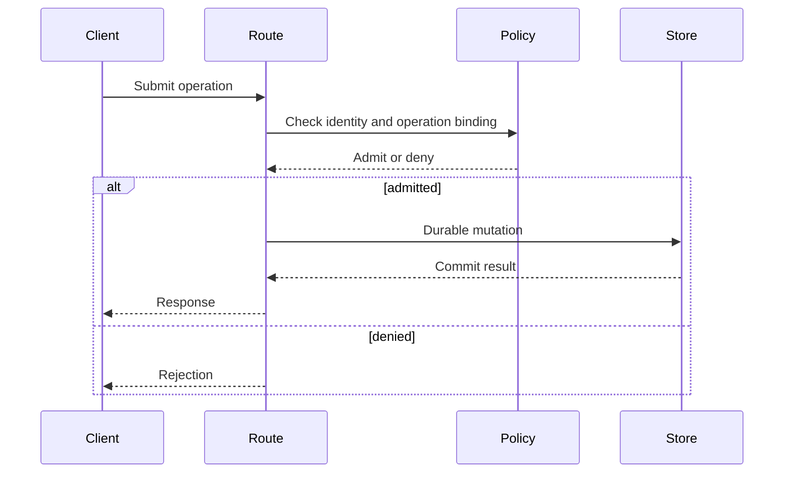

# Diagnose competing paths with diagrams

Use this when a failure crosses several modules, there may be multiple writers
or validators, or successive local fixes keep missing the cause. Read actual
source and callers; old architecture drawings are leads, not current evidence.

## Map the journey

Partition by concern: request admission, identity, storage, events, rendering,
background processing or another boundary relevant to the bug. Map each in the
same session or delegate independent slices if authorised and available.
Record participants as actual executions; a named logical role is not a worker.

For each slice retain entry point, selected feature/configuration, consumed
dependency revision, calls, state stores, success/error branches and source
anchors at a full commit. Include shadow paths and unfinished migrations.
A sequence diagram exposes order and effects; a flowchart exposes branching
and authority. Render the diagram to catch syntax/layout problems, then review
its claims against code. Rendering is not semantic verification.

This is a teaching example, not a source-verified diagram of a product. A real
diagram must also show secondary writes, retries and response construction
where those affect the finding.

## Compare before merging paths

Build a small anomaly register: claim, paths/callers, contract differences,
live/partial/retired state, source revision, relevant introducing change,
reproduction and disposition. Compare inputs, outputs, authority, side effects
and compatibility. Similar names do not make two protocols duplicates.

For each candidate choose an explicit outcome: shared owner with consumer
adapters; intentional policy variants; remove a proven retired path; or retain
an unresolved question. Keep rejected duplicate candidates and reasons so the
next reviewer does not repeat the same investigation.

## Prove and repair

Create a failing probe at the smallest real seam, with a valid control. Pure
model tests avoid irrelevant GPU/network setup when they establish the claim.
For admission, persistence or user-visible delivery, also exercise the actual
consumer. Follow discovery links returned by the system rather than guessing
where a resource should live.

Repair the owning implementation or actual routing. Run shared fixtures through
each affected consumer, including intentional policy differences. Before
deleting a parallel path, inspect callers, feature gates, packaged consumers
and its compatibility role. Correct diagrams and decisions after the code is
committed; preserve historical stamps and append current evidence instead of
rewriting the history of an earlier review.

When useful for Rust, Sealmap's dense/generated views can expose call edges.
They are extraction aids with unresolved/inferred edges, not proof that a
runtime takes the path. Packs bound context; they have not demonstrated a
general review-quality advantage over full source that fits in context.
